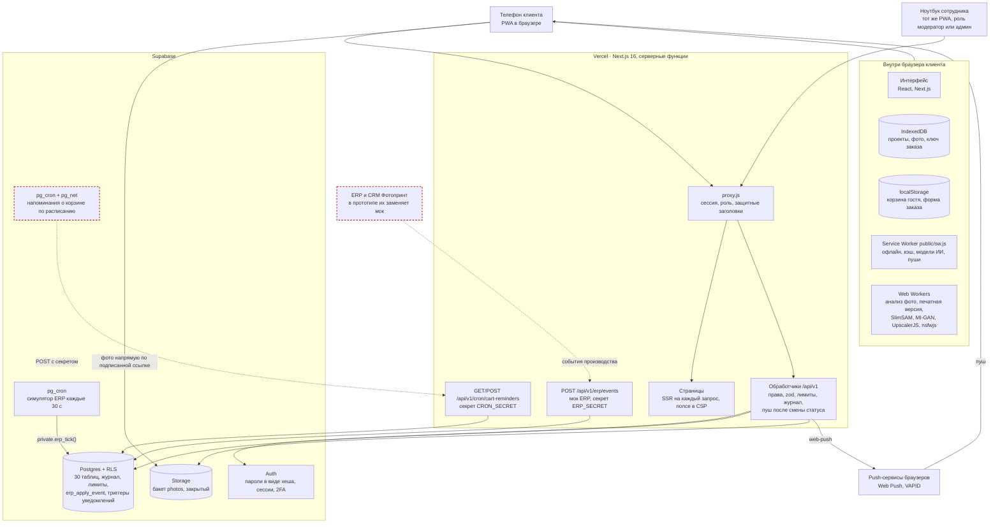
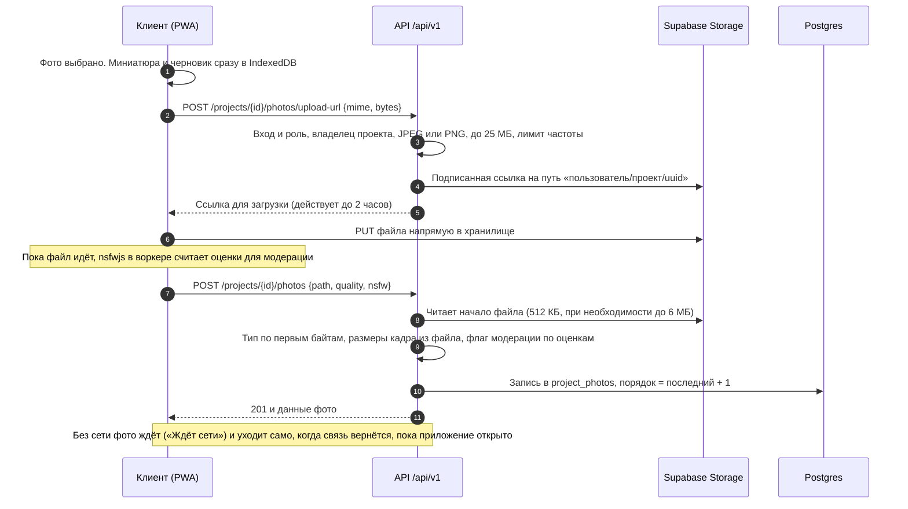
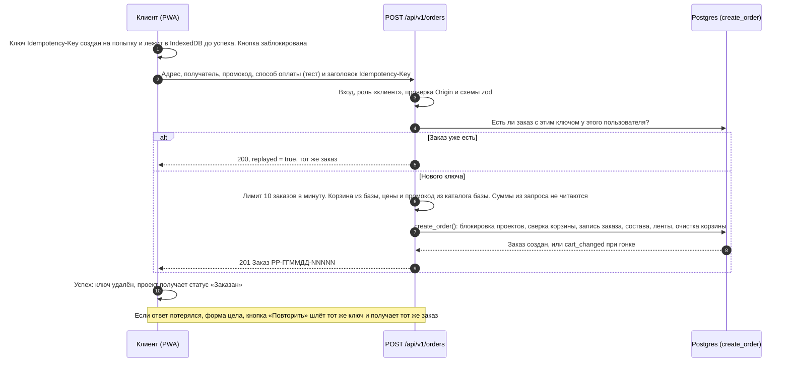
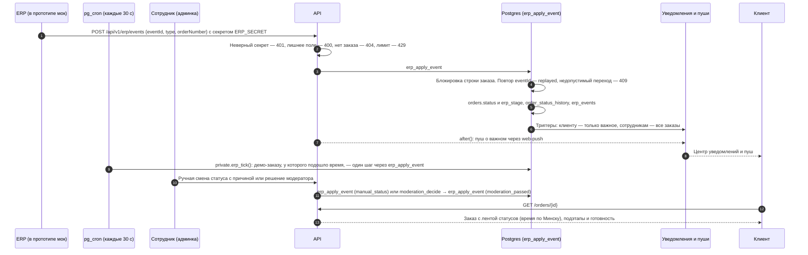
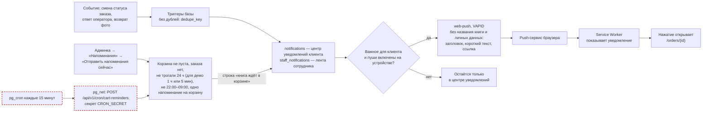
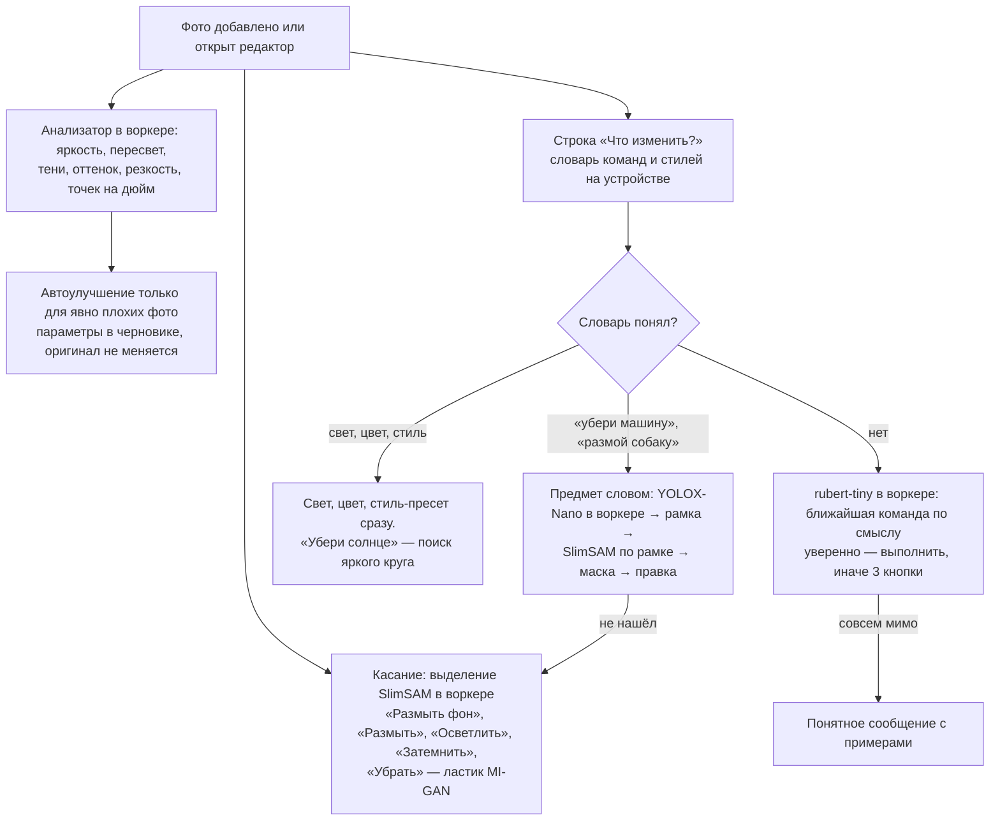
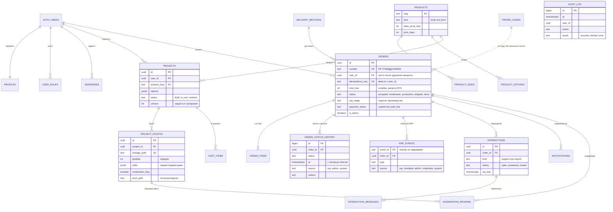
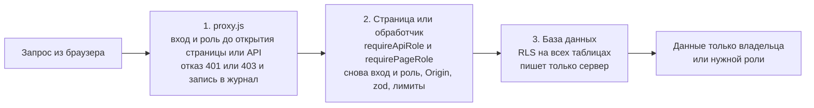

# Архитектура PicPac App

PicPac App — мобильное веб-приложение (PWA) для заказа фотокниг и печати фото, плюс админ-раздел для сотрудников. Один код, один адрес: клиент работает с телефона, модератор и администратор — с компьютера. Всё работает на тестовых и синтетических данных.

Коротко: браузер клиента хранит черновики у себя и синхронизирует их с аккаунтом; сервер на Next.js проверяет права, считает цены и пишет журнал; Supabase даёт базу с правилами доступа, вход и закрытое хранилище фото. ИИ-правки работают на устройстве — обычные алгоритмы и нейросети в Web Worker (выделение касанием, ластик, резкость для печати, первичная проверка фото для модерации), фото для них никуда не уходит; облачного ИИ нет (ночь 2, N3). Статусы заказов меняет мок ERP: события `POST /api/v1/erp/events` и симулятор, которого каждые 30 секунд запускает pg_cron, проходят через одну функцию базы `erp_apply_event`. Есть чат оператора, центр уведомлений клиента и лента сотрудника, очередь модерации и пуши (Web Push).

Состояние описано на 12.11.2026 (ветка `night-day`: дневные этапы D1–D7 и исправления по ручному тесту команды).

Пунктир на схемах ниже — то, что **ещё не сделано** (план, см. раздел 8).

## 1. Компоненты

Что за что отвечает:

| Часть | Роль |
|---|---|
| PWA в браузере | Интерфейс, черновики на устройстве (IndexedDB), очередь без сети, ИИ на устройстве в Web Worker. Гость работает без входа |
| `proxy.js` | Первая линия защиты: продлевает сессию, закрывает `/admin` и `/api/v1/admin/*` по роли, пишет отказы в журнал |
| Обработчики `/api/v1` | Вторая линия: вход и роль в каждом запросе, проверка ввода (`zod`), лимиты частоты, пересчёт цен, журнал действий. После события ERP, ручной смены статуса или ответа оператора — отправка пушей через `after()`, не задерживая ответ |
| Supabase Postgres | Данные и третья линия защиты — правила доступа RLS. Создание заказа — одной транзакцией (функция `create_order`); любая смена статуса — функция `erp_apply_event`; уведомления клиенту и сотрудникам создают триггеры базы |
| Supabase Auth | Регистрация и вход, пароли хранятся только в виде хеша, сессия в cookies `httpOnly`, 2FA для сотрудников за флагом |
| Supabase Storage | Закрытый бакет `photos`: только JPEG и PNG до 25 МБ; доступ по подписанным ссылкам |
| pg_cron (Supabase) | Каждые 30 секунд `private.erp_tick()` двигает демо-заказы на один шаг через ту же `erp_apply_event` (миграция `0013`). Заказы тестовых аккаунтов (`e2e-…`, `critic-…`) не трогает — их двигает ленивый путь при чтении заказа, поэтому тесты детерминированы |
| Мок ERP | `POST /api/v1/erp/events` с секретом `ERP_SECRET` принимает события производства в формате, который ждём от настоящей ERP: повтор `eventId` не задваивает ленту, недопустимый переход — 409 |
| Web Push | `web-push` с ключами VAPID (`lib/pushSend.js`): пуш о важном уходит один раз на строку центра уведомлений (`notifications.pushed_at`), без названия книги и личных данных. Подписка — только по нажатию в профиле, привязана к сессии входа |
| ERP и CRM Фотопринт (план) | В прототипе их заменяют мок ERP и таблицы обращений с чатом оператора; адаптер к настоящим системам — задача пилота ([pilot-plan.md](pilot-plan.md)) |

## 2. Стек

| Что | Версия | Зачем |
|---|---|---|
| Next.js (App Router), React | 16.4.6, 19.3.1 | страницы, серверные обработчики, `proxy.js` |
| Node.js | 26.x | среда выполнения и сборки |
| Supabase | `supabase-js` 2.119.0, `@supabase/ssr` 0.12.7 | база, вход, хранилище |
| pg_cron (расширение Postgres в Supabase) | — | расписание симулятора ERP (каждые 30 с) |
| `zod` | 4.6.7 | проверка ввода на сервере, сообщения по-русски |
| IndexedDB (API браузера, `lib/draft.js`) | — | проекты, фото, ключ идемпотентности |
| `@dnd-kit` | core 6.3.1, sortable 10.0.0 | порядок фото: мышь и клавиатура |
| `@huggingface/transformers`, `onnxruntime-web`, `@tensorflow/tfjs`, `nsfwjs`, `upscaler` | 4.3.2, 1.31.1, 4.11.0, 4.3.0, 1.0.0 | ИИ на устройстве, только в Web Worker: выделение касанием (SlimSAM) и ластик (MI-GAN), «Резкость для печати ×2» (UpscalerJS), первичная проверка фото для модерации (nsfwjs). В код главной и каталога не попадают |
| `web-push` | 4.0.0 | отправка пушей с сервера (VAPID) |
| Playwright, `node:test`, `@axe-core/playwright` | 1.65.0, встроен в Node, 4.14.0 | e2e (в установленном Chrome), unit и API-тесты, проверка доступности (`npm run test:a11y`) |
| Язык | JavaScript | без TypeScript |
| Хостинг | Vercel (Hobby) и Supabase | сборка по `git push` |
| PWA | свой `public/sw.js`, `app/manifest.js` | установка, офлайн, кэш оболочки и моделей ИИ, пуши |

Шрифт Jost и стиль `--ds-*` взяты у super.picpac.by. Лицензии всех компонентов — [licenses.md](licenses.md).

## 3. Потоки данных

### 3.1 Загрузка фото

Фото не идут через сервер Vercel: сервер лишь выдаёт одноразовую ссылку и потом проверяет, что лежит в хранилище.

Что это даёт: подделка вроде текста под видом `.jpg` отклоняется и файл удаляется; имя файла клиента не используется; чужой путь отвергается; заказанный проект менять нельзя (409 и триггер в базе). Флаг «нужен модератор» сервер ставит по оценкам с устройства: porn + hentai > 0,7 или sexy > 0,85; если оценить не получилось (мало памяти, дольше 25 с), фото уходит без оценок. Для показа жюри кнопка «Отправить фото на модерацию (демо)» на шаге «Проверка» (только администратор, аккаунты жюри и тестовые) ставит одному фото оценки «подозрительно» через `PATCH /api/v1/projects/{id}/photos/{photoId}` — дальше путь тот же.

### 3.2 Заказ с идемпотентностью

Повторная отправка не создаёт второй заказ — на трёх уровнях: ключ в браузере, ответ сервера на тот же ключ, уникальный индекс в базе.

Защита от двойного заказа: уникальный индекс `(user_id, idempotency_key)`, блокировка проектов `FOR UPDATE` внутри `create_order` (два параллельных заказа с разными ключами на одну корзину дают один заказ и один отказ 409 `cart_changed`), кнопка блокируется на время запроса. Сразу после создания корзина отправляет тестовую оплату (`POST /api/v1/orders/{id}/pay-test`, деньги не списываются) — с неё начинается движение статусов.

### 3.3 Статусы заказа и мок ERP

Пять статусов ТЗ: «Принят» → «Модерация» → «Производство» → «Готов / передан в доставку» → «Завершён». В «Производстве» — подэтапы «Печать», «Напечатано», «Переплёт и сборка», «Упаковано» и полоска готовности. Любой переход — событие, и все события проходят через одну функцию базы `public.erp_apply_event`: события ERP, симулятор, решение модератора и ручная смена статуса администратором.

Как это работает в прототипе:

- **События ERP** (`moderation_passed`, `print_started`, `printed`, `bound`, `packed`, `handed_to_delivery`, `delivered`) принимает `POST /api/v1/erp/events`. Отказы (409 `invalid_transition`, `moderation_pending`, `idempotency_conflict`) событиями не сохраняются, только пишутся в журнал: событие, пришедшее раньше времени, можно повторить с тем же `eventId`.
- **Симулятор ERP** — на стенде вместо настоящей ERP. pg_cron каждые 30 секунд вызывает `private.erp_tick()` (миграция `0013`): каждому демо-заказу, у которого подошло время, — один шаг через `erp_apply_event`; шаг — 30 секунд после прошлого, доставка — 60. Статус меняется сам, даже если клиент не открывает заказ. Заказы тестовых аккаунтов двигает только ленивый путь при чтении (`public.erp_tick_orders` на `GET /orders`, `GET /orders/{id}` и `GET /notifications`). Синтетические заказы стоят на месте. Выключить, ничего не удаляя: `private.app_settings` → `erp_sim` → `"cron": false`.
- **Ручная смена статуса** — только администратор, карточка заказа `/admin/orders/{id}`: один из 5 статусов и причина от 5 символов (проверка и в `zod`, и в SQL). В ленте — источник «сотрудник» и причина, в журнале — `order.status_change`; клиент видит нейтральное «Статус изменил оператор PicPac».
- **Модерация:** при входе заказа в «Модерацию» фото с флагом попадают в очередь (`moderation_reviews`), заказ ждёт человека; без флагов — автоодобрение, автоматика никогда не отклоняет. «Одобрить» → `moderation_passed` через ту же функцию → «Производство». «Вернуть на замену» — только с причиной из списка: заказ остаётся на «Модерации», клиенту — уведомление «Нужно заменить фото» и причина в заказе.
- Пока нет тестовой оплаты, заказ остаётся «Принят».

### 3.4 Уведомления, пуши и забытая корзина

- **Клиенту — только важное:** «Заказ принят», «Заказ готов и передан в доставку», «Заказ завершён», «Ответ поддержки», «Нужно заменить фото». Значок с числом в шапке, экран `/notifications`, «Прочитать все». **Сотрудникам** — лента `/admin/notifications`: админ видит все заказы (новый заказ и каждую смену статуса) и обращения, модератор — только модерацию.
- **Пуши** — по согласию: профиль → «Уведомления на этом устройстве». Пушем приходит: заказ передан в доставку, завершён, ответ поддержки, книга ждёт в корзине. Отправка (`pushPendingNotifications`) запускается сразу после события ERP, ручной смены статуса или ответа оператора (`after()`) и при рассылке напоминаний; строки от шагов симулятора по расписанию и решения модератора уходят при следующем таком запуске. Подписка привязана к пользователю и сессии входа; при выходе удаляется и на устройстве, и на сервере. Если пуши недоступны (iPhone без установки на экран «Домой», отказ в разрешении), тот же текст есть в центре уведомлений.
- **Забытая корзина:** одно напоминание на корзину (таблица `cart_reminders`, ключ — состав корзины), не ночью. Запуск — кнопкой в админке или вызовом `/api/v1/cron/cart-reminders` с `CRON_SECRET`. Расписание для напоминаний (pg_cron + pg_net) **не включено** — на схеме пунктиром. Гостевая корзина живёт только на устройстве — гостю напомнить нельзя.
- Доставка до системного уведомления доказана в настоящем Chrome на Mac (этап D9, `scripts/push-proof.mjs`; причина прежней недоставки — закрытый ключ VAPID 31 байт, `lib/pushSend.js` дополняет его до 32). Результат каждой отправки — принято (201) или код ошибки; 404/410 — подписка удаляется. На реальных iPhone и Android — проверить перед защитой. Для показа — админка → «Демо пушей» (`/admin/push`, только администратор): тестовый пуш, напоминание о корзине, шаг заказа.

### 3.5 ИИ-правка

Правило (ночь 2, N3): ИИ-редактор целиком на устройстве, облака нет. Во время правок ни фото, ни текст команд, ни сведения о содержимом фото не уходят с телефона; модели — с нашего сайта, в кэше сервис-воркера (дальше — без интернета).

Всегда: оригинал можно вернуть, правки хранятся параметрами в черновике (маски выделения — сжатыми, до 320 точек; стиль — `look { mono, sepia, fade }`), изменённое фото помечено значком. При «Подтвердить заказ» для изменённых фото на устройстве собирается «печатная версия» полного разрешения со всеми правками и загружается рядом с оригиналом; оригинал загружается без EXIF и GPS. Модели (≈ 90 МБ вместе с wasm) лежат на нашем сайте, грузятся по нажатию или заранее кнопкой «Скачать ИИ заранее» и остаются в кэше сервис-воркера.

## 4. Модель данных

### 4.1 Соответствие сущностям ТЗ (раздел 4.2)

| Сущность ТЗ | Где в базе | Комментарий |
|---|---|---|
| `user` | `auth.users`, `profiles`, `user_roles` | пароли и сессии — в Supabase Auth; роли `client`, `moderator`, `admin` |
| `customer` | `profiles`, `addresses` | клиент = пользователь с ролью `client`; сохранённый адрес пока на устройстве |
| `product` | `products`, `product_sizes`, `product_options`, `delivery_methods`, `promo_codes` | каталог; цены в копейках BYN |
| `project` | `projects`, `project_photos`, `cart_items` | `version` защищает от затирания с другого устройства; правки фото — в `project_photos.edits`, флаг модерации — `moderation_flag` |
| `order` | `orders`, `order_items` | суммы в копейках; в `order_items.snapshot` — снимок проекта и список фото на момент заказа |
| `order_status` | `order_status_history`, `orders.status`, `erp_events` | пять статусов и подэтапы производства, источник `erp`, `admin` или `system`, причина; принятые события ERP с `eventId` |
| `interaction` | `interactions`, `interaction_messages` | обращение по заказу (`support`) или заявка на перепечатку (`reprint`), срок ответа `sla_due`, автор: клиент, бот, оператор |
| `metric` | `analytics_events` и расчёты админки | обезличенные события воронки (`POST /api/v1/events`), сводка — функция базы `analytics_summary`, дашборд `/admin/stats` |
| `alert` | `notifications`, `staff_notifications` и просрочки обращений | центр уведомлений клиента и лента сотрудника, строки создают триггеры базы; просрочки заказов и обращений без ответа видны на дашборде `/admin/stats` |
| `meeting`, `task`, `document` | — | относятся к треку 3, в этом решении не используются |

Служебное: `audit_log` (журнал действий), `moderation_reviews` (очередь модерации и решения), `staff_notification_reads`, `cart_reminders`, `notification_settings`, `push_subscriptions`, `ai_cloud_consents`, `ai_cloud_usage`, `ai_cloud_budget`, `data_requests`, схема `private` (`rate_limits`, `app_settings`).

### 4.2 Схема связей

На схеме не показаны `staff_notifications`, `staff_notification_reads`, `notification_settings`, `push_subscriptions`, `cart_reminders`, `ai_cloud_consents`, `ai_cloud_usage`, `ai_cloud_budget`, `analytics_events`, `data_requests`, `private.rate_limits` и `private.app_settings`. `audit_log` и `analytics_events` не связаны внешними ключами нарочно: записи остаются после удаления аккаунта.

### 4.3 Правила хранения

- **Деньги** — целые копейки (`*_kop`) и валюта `BYN`. В ответах API дублируются рублями для показа.
- **Даты** — `timestamptz` (UTC в базе), показываем по Минску (`Europe/Minsk`, UTC+3).
- **Номер заказа** `PP-ГГММДД-NNNNN` — дата по Минску и порядковый номер из последовательности базы.
- **Удаление аккаунта**: профиль, проекты, фото (и файлы), корзина, подписки удаляются; заказы остаются обезличенными (`user_id` пуст, получатель и адрес очищены, `anonymized_at`). Журнал неизменяемый.
- **Тестовые данные** помечены `is_demo` и `is_synthetic`; демо-заказы двигает симулятор ERP (pg_cron каждые 30 с), синтетические стоят на месте.

Почта: в `audit_log.details` у действий вошедшего пользователя записана его почта. Журнал неизменяемый, поэтому после удаления аккаунта почта в нём остаётся — он нужен для разбора инцидентов (решение S04, описано в README и [security.md](security.md)). Для пилота — хранить хеш вместо почты или срок хранения журнала.

## 5. Роли и права

Роли: `client` (клиент), `moderator`, `admin`. Гость — без входа. У `admin@example.com` две роли (клиент и администратор), поэтому после входа показывается экран выбора роли. Роль — это cookie `pp_role`, но сама по себе она прав не даёт: сервер в каждом запросе сверяет её с таблицей `user_roles`, и роли действуют только при живой сессии входа (функция базы `session_roles()`).

### 5.1 Что кому доступно

| Раздел | Гость | Клиент | Модератор | Админ |
|---|---|---|---|---|
| Каталог, карточка, редактор, корзина (на устройстве) | да | да | да | да |
| Проекты, корзина и заказы в аккаунте, обращения, уведомления клиента, удаление своих фото (`/api/v1/projects`, `/cart`, `/orders`, `/interactions`, `/notifications`, `/me/photos`) | 401 | да | 403 | да, но только в активной роли «клиент» |
| Профиль, выгрузка своих данных, удаление аккаунта (`/api/v1/me`, `/me/export`) | 401 (`GET /me` отвечает «не вошёл») | да | да | да |
| `/admin` — обзор заказов и обращений (без данных клиентов), `/admin/moderation` — очередь модерации, `/admin/notifications` — лента сотрудника | 401 | 403 | да | да |
| `/admin/orders/{id}` — карточка заказа и смена статуса с причиной, `/admin/support/{id}` — чат оператора | 401 | 403 | 403 | да |
| `/admin/audit` — журнал, `/admin/stats` — дашборд, `/admin/reminders` — напоминания о корзине, `/admin/push` — демо пушей | 401 | 403 | 403 | да |
| Правка каталога и цен, пользователи и роли в админке | — | — | — | не сделано |

### 5.2 Три линии защиты

Важные детали:

- Чужие объекты (проект, фото, заказ, обращение) отвечают `404`, а не `403`: так не подсказываем, что они существуют.
- Гость с публичным ключом Supabase не видит ни одной строки и ни одного файла (проверяет `npm run test:api`); вошедший клиент по тому же ключу увидит только свои строки.
- Запись в таблицы возможна только с серверным секретным ключом после проверок кода.
- Журнал `audit_log` нельзя изменить и удалить никому: это запрещают права и триггеры в базе.
- Попытка подмены cookie роли даёт `403` и запись в журнал.
- После выхода, «выйти везде» или удаления аккаунта старые cookies сразу не дают доступа: роли выдаются только живой сессии.

### 5.3 Данные клиента у сотрудников

Маскирование сделано (SEC-14): оператор (администратор) в карточке заказа и в чате видит «Тест Т.», телефон «+375 ••••••• 67», почту «t•••@…», только город или «Пункт выдачи (скрыт)» — полные контакты и адрес нужны только службе доставки. Модератор видит только инициалы клиента, без адреса; фото в очереди — по подписанной ссылке на 10 минут и размыто до «Показать фото». Своим ключом модератор не читает заказы и фото клиентов: это запрещают ограничивающие правила RLS (миграция `0008`), экраны сотрудников получают данные через сервер после проверки роли.

## 6. Интеграции: что настоящее, что имитация

| Интеграция (ТЗ 4.2) | В прототипе | Что нужно для пилота |
|---|---|---|
| ERP / заказы | заказы и статусы в нашей базе; мок ERP — `POST /api/v1/erp/events` с секретом и защитой от повторов; на стенде события шлёт симулятор (pg_cron каждые 30 с) через ту же функцию `erp_apply_event` | адаптер к настоящему API ERP, тот же набор событий, подпись запросов — см. [pilot-plan.md](pilot-plan.md) |
| CRM / поддержка | обращения по заказу, бот отвечает по данным заказа (статус, готовность, дата доставки), срок ответа `sla_due`, чат оператора в админке, заявка на перепечатку с причиной | двусторонняя синхронизация клиентов и обращений |
| Платежи | только тестовые: «Карта (тест)» и «ЕРИП (тест)», деньги не списываются | bePaid: карты и ЕРИП, вебхуки |
| Файловое хранилище | Supabase Storage, закрытый бакет | хранилище в Республике Беларусь |
| Уведомления | центр уведомлений клиента и лента сотрудника в базе; Web Push по согласию (VAPID) | те же, плюс SMS/почта по решению Фотопринт |
| ИИ | только на устройстве: алгоритмы и нейросети в Web Worker (SlimSAM, MI-GAN, YOLOX-Nano, rubert-tiny, ESRGAN-slim, nsfwjs), облака нет | оценка собственного сервера с моделями |

Контракт API описан в [api/openapi.yaml](api/openapi.yaml) (OpenAPI 3.1, примеры успеха и ошибок), готовые запросы — [api/examples.http](api/examples.http).

## 7. Надёжность и наблюдаемость

- **Единый формат ошибки** `{ ok: false, error: { code, message, requestId, fields? } }`: текст по-русски, `requestId` дублируется в заголовке `X-Request-Id` — по нему ошибку находят в логах.
- **Журнал действий** (ОТ-04): кто, когда, что, над чем, результат, IP. Экран `/admin/audit` для администратора: фильтры по действию, результату, роли, пользователю, датам и объекту, «Скрыть автотесты» включено по умолчанию.
- **Лимиты частоты** через функцию `rate_limit_hit` в базе: 429 и `Retry-After`.
- **Устойчивость к обрывам:** черновик живёт на устройстве, синхронизация повторяется сама, заказ защищён ключом идемпотентности, версия проекта защищает от затирания; повтор события ERP не задваивает ленту.
- **Расписание в базе:** pg_cron `picpac-erp-tick` (каждые 30 с) и раз в сутки — очистка истории запусков pg_cron старше 3 дней. Если pg_cron недоступен, статусы демо-заказов двигает ленивый путь при чтении заказа.
- **Проверки:** `npm run test:all` — lint, сборка, unit, лицензии, API, вход и роли, e2e (Playwright, телефон 390×844 и компьютер 1280×800), доступность (axe); отдельно `npm run security:scan`. Числа последнего прогона — [test-report.md](test-report.md).
- **Логи сервера** — Vercel. Ошибки базы пишутся в лог без персональных данных.
- **Резервные копии**: `npm run db:backup` перед каждой миграцией (только таблицы `public`).

## 8. Что готово и что нет

| Часть | Состояние |
|---|---|
| Каталог из базы, карточка, редактор, проекты, синхронизация с аккаунтом, корзина, заказ с идемпотентностью, экраны заказов, выход со стиранием устройства | готово (S01–S02e) |
| Фото продуктов в каталоге и на страницах продуктов (сжатые WebP, собираются на сервере) | готово (12.11) |
| Мок ERP: `POST /api/v1/erp/events`, одна функция `erp_apply_event`, подэтапы и готовность, ручная смена статуса с причиной; симулятор по расписанию pg_cron каждые 30 с | готово (D3, расписание — 12.11); настоящая ERP — пилот |
| Обращения: бот отвечает по данным заказа, чат оператора в админке, «Перепечатка» у завершённого заказа (обращение с причиной) | готово (D3, 12.11) |
| Центр уведомлений клиента и лента сотрудника | готово (D3) |
| Пуши (Web Push), напоминание о забытой корзине (одно, не ночью), «Демо пушей» и «Проверить уведомления» | готово (D5, D9): доставка доказана в Chrome на Mac, на iPhone и Android — проверить перед защитой; напоминания запускаются кнопкой, расписание (pg_cron + pg_net) не включено |
| QR и установка на телефон: `/qr`, «Открыть на телефоне» в подвале на компьютере, «Как установить на телефон» в «Помощи» | готово (D9) |
| Модерация: nsfwjs на устройстве, плашка «Это фото проверит модератор», очередь «Одобрить» / «Вернуть на замену», демо-кнопка для жюри | готово (D4, 12.11); замены фото клиентом после возврата нет |
| ИИ на устройстве: анализ, автоулучшение, команды, «до/после», «убери солнце» (эвристика), выделение касанием (SlimSAM), «Размыть фон», ластик (MI-GAN), «Резкость для печати ×2» (UpscalerJS), печатная версия, «Скачать ИИ заранее» | готово (S03, D1, 12.11) |
| Облачный ИИ (Cloudflare) | удалён в ночь 2 (N3): поиск предмета словом и разбор свободных фраз — на устройстве (YOLOX-Nano, rubert-tiny) |
| Service Worker, офлайн, установка, прямые ссылки | готово (S07) |
| Аналитика воронки, дашборд `/admin/stats`, синтетические и демо-данные | готово (S10) |
| Строгая CSP с nonce и заголовки безопасности, поиск секретов, `npm audit`, роли только при живой сессии, фильтры журнала, маскировка данных клиента | готово (S04, D3, D7); замечания — в [security.md](security.md) |
| Доступность (WCAG AA, `npm run test:a11y`), «Помощь», «Крупный текст», раскладка для компьютера | готово (D2) |
| Правка каталога и цен, управление пользователями в админке | не сделано |

## 9. Принятые решения

| Решение | Почему |
|---|---|
| PWA, а не нативное приложение | ТЗ допускает PWA; один код для iPhone, Android и компьютера; не нужны магазины приложений. Путь к нативным оболочкам — в [pilot-plan.md](pilot-plan.md) |
| Фото грузим в хранилище напрямую | Серверные функции Vercel принимают тело запроса примерно до 4,5 МБ; фото до 25 МБ |
| Цену и итог считает сервер | Суммы из запроса не читаются, подмена цены невозможна; одна формула в `lib/pricing.js` для экрана и сервера |
| Деньги в копейках | Нет ошибок округления дробных чисел |
| RLS на всех таблицах, запись только сервером | Даже ошибка в коде API не открывает чужие данные по публичному ключу |
| Журнал только на добавление | Записи нельзя подправить задним числом |
| Одна функция смены статуса `erp_apply_event` | События ERP, симулятор, модератор и ручная смена проходят одни и те же проверки и пишут одну ленту; настоящая ERP подключается без изменений экранов |
| Симулятор ERP — расписание pg_cron в базе | Демо-заказы двигаются сами каждые 30 с, даже если заказ никто не открывает; заказы автотестов двигает только ленивый путь при чтении — тесты остаются детерминированными |
| ИИ на устройстве в первую очередь | Бесплатно, быстро, фото не покидают телефон; облако — только по согласию и с квотами |
| Первичная проверка фото для модерации на устройстве | Фото не уходит в сторонние сервисы; автоматика только помечает фото, решает человек |
| Каталог в базе и через API | Требование МП-01: цены не зашиты в интерфейс |
| Без TypeScript | Решение команды: меньше сборки, быстрее правки в хакатоне |
