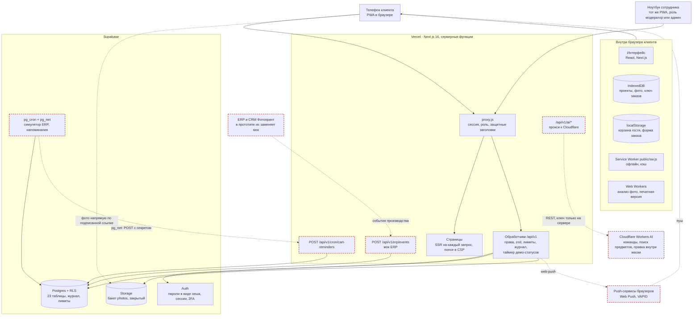
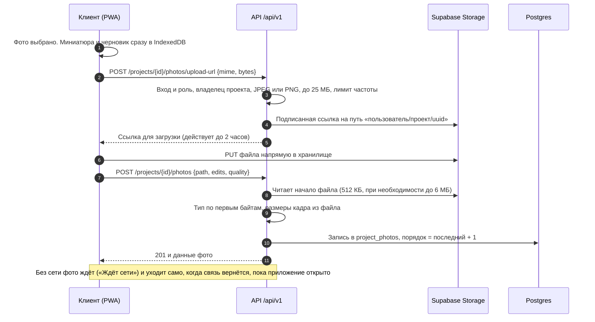
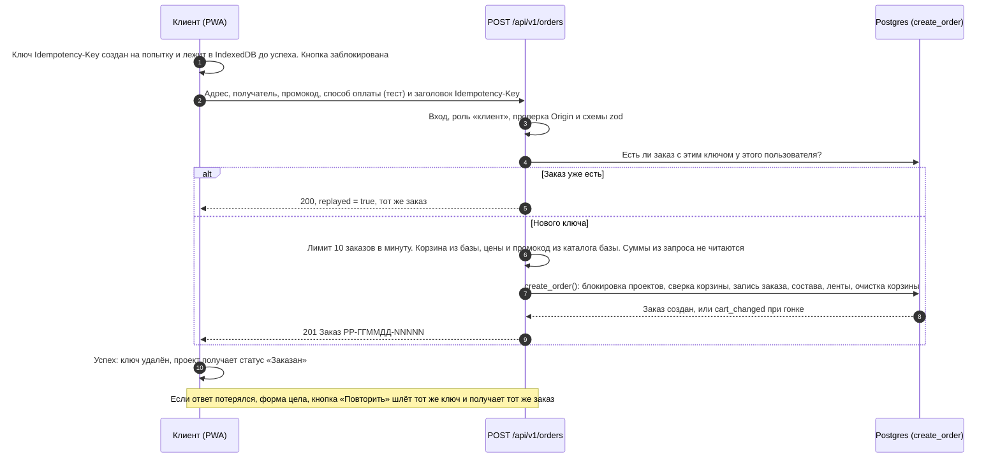
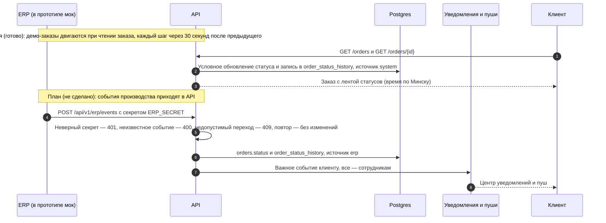
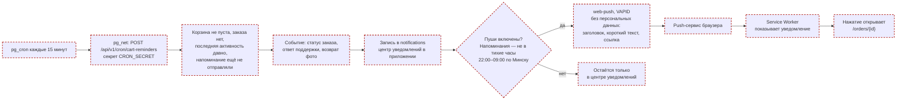
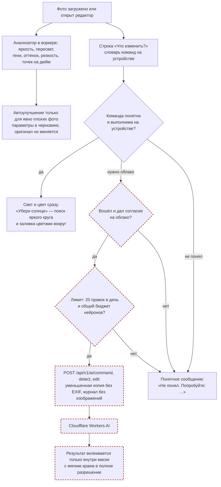
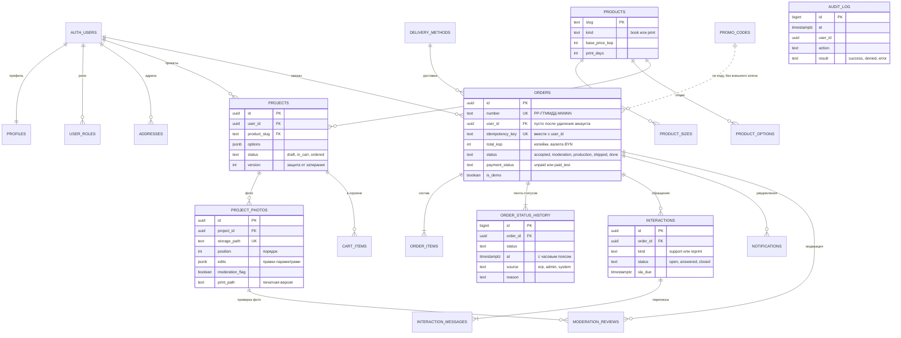
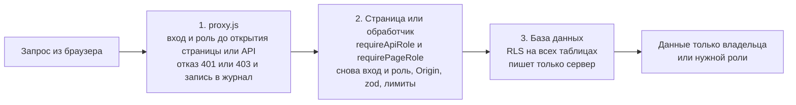

# Архитектура PicPac App

PicPac App — мобильное веб-приложение (PWA) для заказа фотокниг и печати фото, плюс админ-раздел для сотрудников. Один код, один адрес: клиент работает с телефона, модератор и администратор — с компьютера. Всё работает на тестовых и синтетических данных.

Коротко: браузер клиента хранит черновики у себя и синхронизирует их с аккаунтом; сервер на Next.js проверяет права, считает цены и пишет журнал; Supabase даёт базу с правилами доступа, вход и закрытое хранилище фото; ИИ-правки работают на устройстве обычными алгоритмами, без нейросетей и без отправки фото наружу. Облачный ИИ (Cloudflare), мок ERP, пуши и pg_cron — в плане.

Состояние описано на 12.11.2026 (ветка `night`, тег `night-s11`).

Пунктир на схемах ниже — то, что **ещё не сделано** (план, см. раздел 8).

## 1. Компоненты

Что за что отвечает:

| Часть | Роль |
|---|---|
| PWA в браузере | Интерфейс, черновики на устройстве (IndexedDB), очередь без сети, ИИ на устройстве. Гость работает без входа |
| `proxy.js` | Первая линия защиты: продлевает сессию, закрывает `/admin` и `/api/v1/admin/*` по роли, пишет отказы в журнал |
| Обработчики `/api/v1` | Вторая линия: вход и роль в каждом запросе, проверка ввода (`zod`), лимиты частоты, пересчёт цен, журнал действий |
| Supabase Postgres | Данные и третья линия защиты — правила доступа RLS; создание заказа — одной транзакцией (функция `create_order`) |
| Supabase Auth | Регистрация и вход, пароли хранятся только в виде хеша, сессия в cookies `httpOnly`, 2FA для сотрудников за флагом |
| Supabase Storage | Закрытый бакет `photos`: только JPEG и PNG до 25 МБ; доступ по подписанным ссылкам |
| Мок ERP (план) | Должен принимать события производства в формате настоящей ERP. **Не сделан:** сейчас статусы демо-заказов двигает таймер при чтении заказа (`lib/server/orderFlow.js`, шаг каждые 30 с) |
| Cloudflare Workers AI (план) | По согласию клиента: разбор свободных команд, поиск предметов, правка внутри маски. **Сейчас не вызывается.** Подробности — [ai.md](ai.md) |

## 2. Стек

| Что | Версия | Зачем |
|---|---|---|
| Next.js (App Router), React | 16.4.6, 19.3.1 | страницы, серверные обработчики, `proxy.js` |
| Node.js | 26.x | среда выполнения и сборки |
| Supabase | `supabase-js` 2.119.0, `@supabase/ssr` 0.12.7 | база, вход, хранилище |
| `zod` | 4.6.7 | проверка ввода на сервере, сообщения по-русски |
| IndexedDB (API браузера, `lib/draft.js`) | — | проекты, фото, ключ идемпотентности |
| `@dnd-kit` | core 6.3.1, sortable 10.0.0 | порядок фото: мышь и клавиатура |
| `@huggingface/transformers`, `onnxruntime-web`, `@tensorflow/tfjs`, `nsfwjs`, `upscaler` | 4.3.2, 1.31.1, 4.11.0, 4.3.0, 1.0.0 | установлены для будущих ИИ-функций, **в коде не импортируются** и в сборку не попадают |
| `web-push` | 4.0.0 | установлен для пушей, **не используется** (пуши — план) |
| Playwright, `node:test` | 1.65.0 | e2e (в установленном Chrome), unit и API-тесты. `@axe-core/playwright` 4.14.0 установлен, проверка доступности ещё не написана |
| Язык | JavaScript | без TypeScript |
| Хостинг | Vercel (Hobby) и Supabase | сборка по `git push` |
| PWA | свой `public/sw.js`, `app/manifest.js` | установка, офлайн, кэш оболочки |

Шрифт Jost и стиль `--ds-*` взяты у super.picpac.by. Лицензии всех компонентов — [licenses.md](licenses.md).

## 3. Потоки данных

### 3.1 Загрузка фото

Фото не идут через сервер Vercel: сервер лишь выдаёт одноразовую ссылку и потом проверяет, что лежит в хранилище.

Что это даёт: подделка вроде текста под видом `.jpg` отклоняется и файл удаляется; имя файла клиента не используется; чужой путь отвергается; заказанный проект менять нельзя (409 и триггер в базе).

### 3.2 Заказ с идемпотентностью

Повторная отправка не создаёт второй заказ — на трёх уровнях: ключ в браузере, ответ сервера на тот же ключ, уникальный индекс в базе.

Защита от двойного заказа: уникальный индекс `(user_id, idempotency_key)`, блокировка проектов `FOR UPDATE` внутри `create_order` (два параллельных заказа с разными ключами на одну корзину дают один заказ и один отказ 409 `cart_changed`), кнопка блокируется на время запроса.

### 3.3 Статусы заказа и ERP

Пять статусов ТЗ: «Принят» → «Модерация» → «Производство» → «Готов / передан в доставку» → «Завершён». В прототипе производство имитируется.

Сейчас работает только верхняя часть схемы: переход при чтении заказа (`lib/server/orderFlow.js`), условным обновлением, поэтому одновременные чтения не задваивают ленту. Мок ERP (`POST /api/v1/erp/events`, события `moderation_passed`, `print_started`, `printed`, `bound`, `packed`, `handed_to_delivery`, `delivered`), pg_cron и ручная смена статуса администратором с причиной **не сделаны**.

Правила, уже работающие в коде: пока нет тестовой оплаты, заказ остаётся «Принят»; с «Модерации» заказ уходит дальше автоодобрением, только если ни у одного фото нет флага модерации, автоматика сама не отклоняет. Флаг сейчас никто не ставит (проверки nsfwjs нет), поэтому на демо все заказы одобряются автоматически.

### 3.4 Уведомления, пуши и забытая корзина (план)

Вся схема ниже — **план, не сделано**. Сейчас есть только центр уведомлений в профиле: это список сообщений самого приложения на этом устройстве («Заказ … оформлен», «Обращение отправлено»; `notify()` в `lib/store.js`, хранится в `localStorage`). Таблицы `notifications`, `notification_settings`, `push_subscriptions` в базе созданы, но приложение их не использует; пушей, тихих часов и напоминаний о корзине нет.

По плану клиент получает только важное: «Заказ принят», «Нужно заменить фото», «Готов / передан в доставку», «Ответ поддержки», «Заказ завершён». Сотрудники видят все заказы. Одно напоминание о корзине на корзину, без давления. Если пуши недоступны (iPhone без установки на экран, отказ в разрешении), тот же текст виден в центре уведомлений.

### 3.5 ИИ-правка

Правило: пока можно, всё делается на устройстве; облако — только вошедшему клиенту после согласия. Сейчас работает левая часть схемы (сплошные блоки); облачная часть — план.

Всегда: оригинал можно вернуть, правки хранятся параметрами в черновике, изменённое фото помечено значком. При «Подтвердить заказ» для изменённых фото на устройстве собирается «печатная версия» полного разрешения и загружается рядом с оригиналом. Не сделано: выделение касанием (SlimSAM), ластик (MI-GAN), «Размыть фон», резкость для печати, облачные правки.

## 4. Модель данных

### 4.1 Соответствие сущностям ТЗ (раздел 4.2)

| Сущность ТЗ | Где в базе | Комментарий |
|---|---|---|
| `user` | `auth.users`, `profiles`, `user_roles` | пароли и сессии — в Supabase Auth; роли `client`, `moderator`, `admin` |
| `customer` | `profiles`, `addresses` | клиент = пользователь с ролью `client`; сохранённый адрес пока на устройстве |
| `product` | `products`, `product_sizes`, `product_options`, `delivery_methods`, `promo_codes` | каталог; цены в копейках BYN |
| `project` | `projects`, `project_photos`, `cart_items` | `version` защищает от затирания с другого устройства; правки фото — в `project_photos.edits` |
| `order` | `orders`, `order_items` | суммы в копейках; в `order_items.snapshot` — снимок проекта и список фото на момент заказа |
| `order_status` | `order_status_history` и `orders.status` | пять статусов, источник `erp`, `admin` или `system`, причина |
| `interaction` | `interactions`, `interaction_messages` | обращение по заказу, срок ответа `sla_due`, автор: клиент, бот, оператор |
| `metric` | `analytics_events` и расчёты админки | обезличенные события воронки (`POST /api/v1/events`), сводка — функция базы `analytics_summary`, дашборд `/admin/stats` |
| `alert` | `notifications` и просрочки обращений | таблица `notifications` создана, не используется; просрочки заказов и обращений без ответа видны на дашборде `/admin/stats` |
| `meeting`, `task`, `document` | — | относятся к треку 3, в этом решении не используются |

Служебное: `audit_log` (журнал действий), `moderation_reviews`, `data_requests`, `notification_settings`, `push_subscriptions`, схема `private` (`rate_limits`, `app_settings`).

### 4.2 Схема связей

На схеме не показаны `notification_settings`, `push_subscriptions`, `analytics_events`, `data_requests`, `private.rate_limits` и `private.app_settings`. `audit_log` и `analytics_events` не связаны внешними ключами нарочно: записи остаются после удаления аккаунта.

### 4.3 Правила хранения

- **Деньги** — целые копейки (`*_kop`) и валюта `BYN`. В ответах API дублируются рублями для показа.
- **Даты** — `timestamptz` (UTC в базе), показываем по Минску (`Europe/Minsk`, UTC+3).
- **Номер заказа** `PP-ГГММДД-NNNNN` — дата по Минску и порядковый номер из последовательности базы.
- **Удаление аккаунта**: профиль, проекты, фото (и файлы), корзина, подписки удаляются; заказы остаются обезличенными (`user_id` пуст, получатель и адрес очищены, `anonymized_at`). Журнал неизменяемый.
- **Тестовые данные** помечены `is_demo` и `is_synthetic`; демо-заказы двигаются по таймеру.

Почта: в `audit_log.details` у действий вошедшего пользователя записана его почта. Журнал неизменяемый, поэтому после удаления аккаунта почта в нём остаётся — он нужен для разбора инцидентов (решение S04, описано в README и [security.md](security.md)). Для пилота — хранить хеш вместо почты или срок хранения журнала.

## 5. Роли и права

Роли: `client` (клиент), `moderator`, `admin`. Гость — без входа. У `admin@example.com` две роли (клиент и администратор), поэтому после входа показывается экран выбора роли. Роль — это cookie `pp_role`, но сама по себе она прав не даёт: сервер в каждом запросе сверяет её с таблицей `user_roles`.

### 5.1 Что кому доступно

| Раздел | Гость | Клиент | Модератор | Админ |
|---|---|---|---|---|
| Каталог, карточка, редактор, корзина (на устройстве) | да | да | да | да |
| Проекты, корзина и заказы в аккаунте, обращения, удаление своих фото (`/api/v1/projects`, `/cart`, `/orders`, `/interactions`, `/me/photos`) | 401 | да | 403 | да, но только в активной роли «клиент» |
| Профиль, выгрузка своих данных, удаление аккаунта (`/api/v1/me`, `/me/export`) | 401 (`GET /me` отвечает «не вошёл») | да | да | да |
| `/admin` — заказы и обращения | 401 | 403 | да | да |
| `/admin/audit`, `/api/v1/admin/audit` — журнал | 401 | 403 | 403 | да |
| Очередь модерации, смена статуса с причиной, ответы операторов | — | — | не сделано | не сделано |
| `/admin/stats`, `/api/v1/admin/stats` — дашборд | 401 | 403 | 403 | да |
| Правка каталога и цен, пользователи и роли в админке | — | — | — | не сделано |

### 5.2 Три линии защиты

Важные детали:

- Чужие объекты (проект, фото, заказ, обращение) отвечают `404`, а не `403`: так не подсказываем, что они существуют.
- Гость с публичным ключом Supabase не видит ни одной строки и ни одного файла (проверяет `npm run test:api`); вошедший клиент по тому же ключу увидит только свои строки.
- Запись в таблицы возможна только с серверным секретным ключом после проверок кода.
- Журнал `audit_log` нельзя изменить и удалить никому: это запрещают права и триггеры в базе.
- Попытка подмены cookie роли даёт `403` и запись в журнал.

### 5.3 Данные клиента у сотрудников

Экран `/admin` показывает сотруднику только номер, статус, сумму, оплату и дату заказа и тему обращения — без ФИО, телефона и адреса. **Маскирование не сделано** (SEC-14): по правилам RLS модератор может прочитать из базы ФИО, телефон и адрес заказов в статусе «Модерация»; для пилота — показывать частично скрытыми (`+375 (29) ***-**-12`) и отдавать через сервер. Очереди модерации пока нет.

## 6. Интеграции: что настоящее, что имитация

| Интеграция (ТЗ 4.2) | В прототипе | Что нужно для пилота |
|---|---|---|
| ERP / заказы | заказы и статусы в нашей базе; статусы демо-заказов двигает таймер при чтении (шаг 30 с); мок `POST /api/v1/erp/events` не сделан | адаптер к настоящему API ERP, тот же набор событий, подпись запросов — см. [pilot-plan.md](pilot-plan.md) |
| CRM / поддержка | обращения по заказу, ответ бота, срок ответа `sla_due`; очереди и чата оператора нет (ответ оператора есть только в демо-данных) | двусторонняя синхронизация клиентов и обращений |
| Платежи | только тестовые: «Карта (тест)» и «ЕРИП (тест)», деньги не списываются | bePaid: карты и ЕРИП, вебхуки |
| Файловое хранилище | Supabase Storage, закрытый бакет | хранилище в Республике Беларусь |
| Уведомления | центр уведомлений на устройстве (сообщения приложения); Web Push не сделан | те же, плюс SMS/почта по решению Фотопринт |
| ИИ | на устройстве, обычные алгоритмы без нейросетей; облако Cloudflare — план | оценка собственного сервера с моделями |

Контракт API описан в [api/openapi.yaml](api/openapi.yaml) (OpenAPI 3.1, примеры успеха и ошибок), готовые запросы — [api/examples.http](api/examples.http).

## 7. Надёжность и наблюдаемость

- **Единый формат ошибки** `{ ok: false, error: { code, message, requestId, fields? } }`: текст по-русски, `requestId` дублируется в заголовке `X-Request-Id` — по нему ошибку находят в логах.
- **Журнал действий** (ОТ-04): кто, когда, что, над чем, результат, IP. Экран `/admin/audit` для администратора.
- **Лимиты частоты** через функцию `rate_limit_hit` в базе: 429 и `Retry-After`.
- **Устойчивость к обрывам:** черновик живёт на устройстве, синхронизация повторяется сама, заказ защищён ключом идемпотентности, версия проекта защищает от затирания.
- **Проверки** (на теге `night-s10`, подробно — [test-report.md](test-report.md)): `npm run test:unit` — 136, `test:api` — 67, `test:auth` — 15, `e2e` — 10 из 10 (Playwright, телефон 390×844 и компьютер 1280×800), `security:scan`. Автоматической проверки доступности (axe) пока нет.
- **Логи сервера** — Vercel. Ошибки базы пишутся в лог без персональных данных.
- **Резервные копии**: `npm run db:backup` перед каждой миграцией (только таблицы `public`).

## 8. Что готово и что нет

| Часть | Состояние |
|---|---|
| Каталог из базы, карточка, редактор, проекты, синхронизация с аккаунтом, корзина, заказ с идемпотентностью, экраны заказов, обращения с ботом, выход со стиранием устройства | готово (S01–S02e) |
| Демо-статусы по таймеру при чтении заказа | готово; мок ERP, ручная смена статуса с причиной — не сделано |
| ИИ на устройстве: анализ, автоулучшение, команды, «до/после», «убери солнце» (эвристика), печатная версия | готово (S03); SlimSAM, MI-GAN, «Размыть фон», UpscalerJS — не сделано |
| Облако Cloudflare (`/api/v1/ai/*`) | не сделано |
| Service Worker, офлайн, установка, прямые ссылки | готово (S07) |
| Модерация фото (nsfwjs) и очередь модератора | не сделано: на демо — автоодобрение |
| Пуши, напоминание о забытой корзине | не сделано; центр уведомлений — только сообщения приложения на устройстве |
| Аналитика воронки, дашборд `/admin/stats`, синтетические и демо-данные | готово (S10) |
| Строгая CSP с nonce и заголовки безопасности, поиск секретов, `npm audit` | готово (S04); замечания — в [security.md](security.md) |

## 9. Принятые решения

| Решение | Почему |
|---|---|
| PWA, а не нативное приложение | ТЗ допускает PWA; один код для iPhone, Android и компьютера; не нужны магазины приложений. Путь к нативным оболочкам — в [pilot-plan.md](pilot-plan.md) |
| Фото грузим в хранилище напрямую | Серверные функции Vercel принимают тело запроса примерно до 4,5 МБ; фото до 25 МБ |
| Цену и итог считает сервер | Суммы из запроса не читаются, подмена цены невозможна; одна формула в `lib/pricing.js` для экрана и сервера |
| Деньги в копейках | Нет ошибок округления дробных чисел |
| RLS на всех таблицах, запись только сервером | Даже ошибка в коде API не открывает чужие данные по публичному ключу |
| Журнал только на добавление | Записи нельзя подправить задним числом |
| ИИ на устройстве в первую очередь | Бесплатно, быстро, фото не покидают телефон; облако — по согласию (план) |
| Каталог в базе и через API | Требование МП-01: цены не зашиты в интерфейс |
| Без TypeScript | Решение команды: меньше сборки, быстрее правки в хакатоне |
